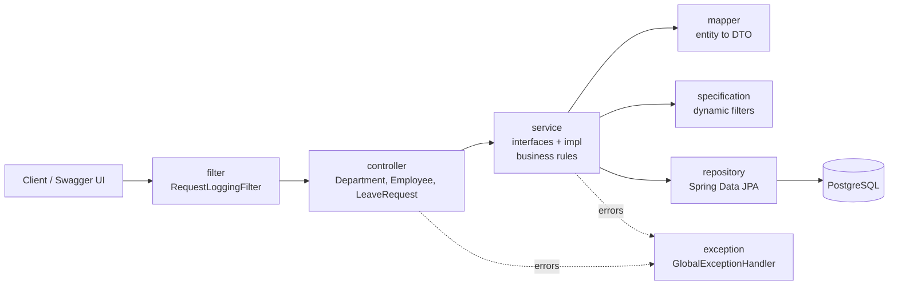
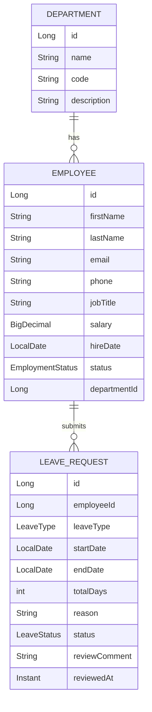
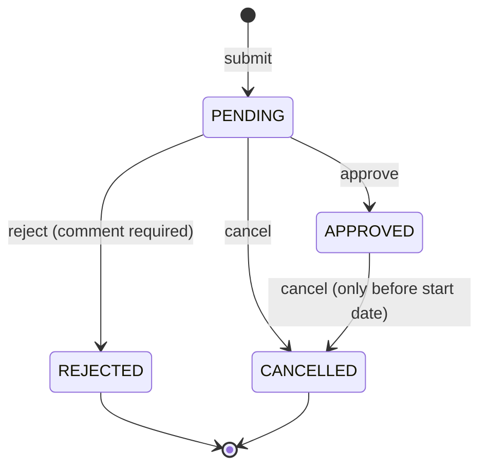

# Employee Management API

A production-style **Spring Boot 4 REST API** for managing departments, employees and leave requests. It is built on **Spring Data JPA and Hibernate** with **PostgreSQL**, and uses a clean layered architecture, DTO-based contracts, centralized validation, global exception handling and request logging.


---

## Table of Contents

1. [Overview](#1-overview)
2. [Demo](#2-demo)
3. [Key Features](#3-key-features)
4. [Tech Stack](#4-tech-stack)
5. [Architecture](#5-architecture)
6. [Project Structure](#6-project-structure)
7. [Domain Model](#7-domain-model)
8. [API Reference](#8-api-reference)
9. [Business Rules and Validation](#9-business-rules-and-validation)
10. [Error Handling](#10-error-handling)
11. [Configuration and Profiles](#11-configuration-and-profiles)
12. [Getting Started](#12-getting-started)
13. [Usage Guide](#13-usage-guide)
14. [Design Decisions](#14-design-decisions)
15. [Current Limitations](#15-current-limitations)
16. [Author](#16-author)

---

## 1. Overview

Employee Management API lets an organization maintain its **departments**, register and search **employees**, and run a complete **leave workflow**: employees request leave, requests are approved, rejected or cancelled, and annual leave balances are enforced against a configurable allowance.

The project was built as the month 2 hands-on task of a Java internship (Spring and Spring Boot fundamentals). It covers the full topic list: IoC and dependency injection, auto-configuration and starters, profiles, REST APIs with Spring Web, request/response handling, exception management, validation, logging and configuration management. Where the task suggested in-memory data, this version goes further and persists everything in **PostgreSQL through Spring Data JPA and Hibernate**.

---

## 2. Demo

| Resource                       | Link |
|--------------------------------|------|
| Source Code (GitHub)           | https://github.com/hassansherwani2610/employee-management-api |
| Source Code (GitLab)           | https://gitlab.com/HassanS10/employee-management-api |
| Interactive API docs (local)   | http://localhost:8080/swagger-ui.html (after starting the app) |

### Sample Response

```json
{
  "success": true,
  "message": "Employee created successfully",
  "data": {
    "id": 1,
    "firstName": "Ali",
    "lastName": "Khan",
    "fullName": "Ali Khan",
    "email": "ali.khan@example.com",
    "phone": "+923001234567",
    "jobTitle": "Backend Developer",
    "salary": 150000.00,
    "hireDate": "2025-03-10",
    "status": "ACTIVE",
    "department": { "id": 1, "name": "Engineering", "code": "ENG" },
    "createdAt": "2026-11-03T10:15:30.123Z",
    "updatedAt": "2026-11-03T10:15:30.123Z"
  },
  "timestamp": "2026-11-03T10:15:30.150Z"
}
```

---

## 3. Key Features

**Departments**
- Create, view, update and delete departments
- Unique name (case-insensitive) and unique code (always stored in upper case)
- Search by name or code, with pagination and sorting
- A department that still has employees cannot be deleted

**Employees**
- Create, view, update and delete employees
- Assigned to a department; email is unique and stored in lower case
- Salary stored as an exact decimal; hire date cannot be in the future
- Dynamic search (name, email, job title) combined with department and status filters
- Employment status: `ACTIVE`, `ON_LEAVE`, `TERMINATED`
- An employee who has leave history cannot be deleted (set the status to `TERMINATED` instead)

**Leave requests**
- Submit, view, update and list leave requests (types: `ANNUAL`, `SICK`, `CASUAL`, `UNPAID`)
- Working days are counted automatically (Saturday and Sunday are excluded)
- Approve, reject (comment required) or cancel a request
- Overlapping leave for the same employee is blocked
- Annual leave balance is enforced against a configurable yearly allowance
- Balance endpoint showing allowance, approved days, pending days and remaining days
- Filter by employee, status, type and date window

**Platform**
- Consistent JSON envelope for every success and error response
- Global exception handling with field-level validation errors
- Pagination (default 10, maximum 50) and whitelisted sorting on every list endpoint
- Request logging with a request ID in every log line and in an `X-Request-Id` response header
- Swagger UI / OpenAPI documentation
- Dev and prod profiles, with secrets loaded from environment variables or a local `.env` file
- Optimistic locking, so two simultaneous edits cannot silently overwrite each other

---

## 4. Tech Stack

### Used in this project

| Area | Technology |
|------|------------|
| Language | Java 21 |
| Framework | Spring Boot 4.1.1 |
| Web | Spring Web MVC (REST controllers) |
| Persistence | Spring Data JPA, Hibernate, PostgreSQL 17 |
| Validation | Jakarta Bean Validation (Hibernate Validator) |
| API docs | springdoc-openapi 3.0.3 (Swagger UI) |
| Monitoring | Spring Boot Actuator (`health`, `info`) |
| Utilities | Lombok |
| Build tool | Gradle 9.7.1 (Gradle Wrapper) |
| Database runtime | Docker Compose |
| Testing | JUnit 5, Spring Boot Test |
| Version control | Git, GitHub and GitLab (dual remotes) |
| IDE | IntelliJ IDEA |

### Concepts applied

Layered architecture, DTO pattern, constructor-based dependency injection, Spring Data repositories, JPA Specifications for dynamic filtering, entity graphs to avoid N+1 queries, optimistic locking, JPA auditing, `@ConfigurationProperties`, profile-based configuration, centralized exception handling with `@RestControllerAdvice`, servlet filters with MDC logging.

---

## 5. Architecture



| Layer | Package | Responsibility |
|-------|---------|----------------|
| Filter | `com.hassan.ems.filter` | Generates a request ID, adds it to the logging context and response header, logs method, path, status and duration. |
| Controller | `com.hassan.ems.controller` | HTTP mapping, `@Valid` request validation, wraps results in `ApiResponse`. No business logic. |
| Service (contract) | `com.hassan.ems.service` | Interfaces describing each module's operations. |
| Service (logic) | `com.hassan.ems.service.impl` | Business rules: uniqueness, referential checks, leave rules, sort whitelisting, transactions. |
| Mapper | `com.hassan.ems.mapper` | Converts requests to entities and entities to response DTOs; normalizes input (trim, case). |
| Specification | `com.hassan.ems.specification` | Reusable, composable query filters for employees and leave requests. |
| Repository | `com.hassan.ems.repository` | Spring Data JPA repositories, custom JPQL queries and entity graphs. |
| Entity | `com.hassan.ems.entity` | JPA entities extending `BaseEntity` (id, version, audit timestamps). |
| DTO | `com.hassan.ems.dto` | Request objects with validation rules and response objects. Entities are never exposed. |
| Exception | `com.hassan.ems.exception` | Domain exceptions and the global handler that maps them to HTTP responses. |
| Config | `com.hassan.ems.config` | JPA auditing, OpenAPI metadata, typed leave properties. |

---

## 6. Project Structure

```text
employee-management-api/
├── build.gradle                       # Dependencies, Java 21 toolchain
├── settings.gradle
├── docker-compose.yml                 # PostgreSQL 17 for local development
├── .env.example                       # Template for local secrets (copy to .env)
├── gradlew / gradlew.bat              # Gradle Wrapper scripts
├── gradle/wrapper/                    # Gradle 9.7.1 distribution config
└── src/
    ├── main/
    │   ├── java/com/hassan/ems/
    │   │   ├── EmployeeManagementApiApplication.java
    │   │   ├── config/
    │   │   │   ├── JpaAuditingConfig.java
    │   │   │   ├── LeaveProperties.java          # ems.leave.* settings
    │   │   │   └── OpenApiConfig.java
    │   │   ├── controller/
    │   │   │   ├── DepartmentController.java
    │   │   │   ├── EmployeeController.java
    │   │   │   └── LeaveRequestController.java
    │   │   ├── dto/
    │   │   │   ├── request/                      # Department, Employee, LeaveCreate/Update/Review
    │   │   │   └── response/                     # ApiResponse, PageResponse, entity responses
    │   │   ├── entity/
    │   │   │   ├── BaseEntity.java               # id, version, createdAt, updatedAt
    │   │   │   ├── Department.java
    │   │   │   ├── Employee.java
    │   │   │   └── LeaveRequest.java
    │   │   ├── enums/                            # EmploymentStatus, LeaveType, LeaveStatus
    │   │   ├── exception/
    │   │   │   ├── GlobalExceptionHandler.java
    │   │   │   ├── ResourceNotFoundException.java
    │   │   │   ├── DuplicateResourceException.java
    │   │   │   ├── BadRequestException.java
    │   │   │   └── ConflictException.java
    │   │   ├── filter/RequestLoggingFilter.java
    │   │   ├── mapper/                           # Department, Employee, Leave mappers
    │   │   ├── repository/                       # Department, Employee, LeaveRequest repositories
    │   │   ├── service/                          # Service interfaces
    │   │   │   └── impl/                         # Service implementations
    │   │   ├── specification/                    # Employee and leave filters
    │   │   └── util/DateUtils.java               # Working-day calculation
    │   └── resources/
    │       ├── application.properties            # Shared settings
    │       ├── application-dev.properties        # Local development profile
    │       └── application-prod.properties       # Production profile
    └── test/java/com/hassan/ems/
        └── EmployeeManagementApiApplicationTests.java
```

> `build/`, `.gradle/`, `.idea/` and your real `.env` file are generated locally and excluded from version control.

---

## 7. Domain Model



Every entity also inherits `id`, `version` (optimistic locking), `createdAt` and `updatedAt` from `BaseEntity`.

**Leave request lifecycle**



Only `PENDING` requests can be edited, approved or rejected.

---

## 8. API Reference

Base path: `/api/v1`. Interactive documentation is available at **`/swagger-ui.html`** and the raw OpenAPI document at **`/v3/api-docs`**.

### Departments

| Method | Endpoint | Description | Success |
|--------|----------|-------------|---------|
| POST | `/departments` | Create a department | 201 |
| GET | `/departments/{id}` | Get one department | 200 |
| GET | `/departments?search=&page=&size=&sort=` | List, search by name or code | 200 |
| PUT | `/departments/{id}` | Update a department | 200 |
| DELETE | `/departments/{id}` | Delete (blocked if it has employees) | 200 |

### Employees

| Method | Endpoint | Description | Success |
|--------|----------|-------------|---------|
| POST | `/employees` | Create an employee | 201 |
| GET | `/employees/{id}` | Get one employee | 200 |
| GET | `/employees?search=&departmentId=&status=&page=&size=&sort=` | List with search and filters | 200 |
| PUT | `/employees/{id}` | Update an employee | 200 |
| DELETE | `/employees/{id}` | Delete (blocked if leave history exists) | 200 |

### Leave requests

| Method | Endpoint | Description | Success |
|--------|----------|-------------|---------|
| POST | `/leave-requests` | Submit a leave request | 201 |
| GET | `/leave-requests/{id}` | Get one leave request | 200 |
| GET | `/leave-requests?employeeId=&status=&leaveType=&from=&to=&page=&size=&sort=` | List with filters | 200 |
| GET | `/leave-requests/balance?employeeId=&year=` | Annual leave balance (year defaults to current) | 200 |
| PUT | `/leave-requests/{id}` | Update a `PENDING` request | 200 |
| PATCH | `/leave-requests/{id}/approve` | Approve (comment optional) | 200 |
| PATCH | `/leave-requests/{id}/reject` | Reject (comment required) | 200 |
| PATCH | `/leave-requests/{id}/cancel` | Cancel | 200 |

### Operations

| Endpoint | Description |
|----------|-------------|
| `/actuator/health` | Application and database health |
| `/actuator/info` | Application info |

### Pagination and sorting

All list endpoints accept `page` (zero-based), `size` (default 10, maximum 50) and `sort=field,asc|desc`. Only whitelisted fields may be sorted; any other field returns `400 Bad Request` with the list of allowed fields. Paginated responses look like this:

```json
{
  "success": true,
  "message": "Departments fetched successfully",
  "data": {
    "content": [ { "id": 1, "name": "Engineering", "code": "ENG" } ],
    "page": 0,
    "size": 10,
    "totalElements": 1,
    "totalPages": 1,
    "first": true,
    "last": true
  },
  "timestamp": "2026-11-03T10:20:00.000Z"
}
```

---

## 9. Business Rules and Validation

Field format rules are checked on the request DTOs (Bean Validation). Uniqueness, referential and workflow rules are enforced in the service layer, and database constraints act as the final safety net.

### Field validation

| Entity | Rules |
|--------|-------|
| Department | Name required, 2 to 100 characters. Code required, 2 to 10 characters, letters, digits, `-` and `_` only (stored in upper case). Description optional, up to 500 characters. |
| Employee | First and last name required, up to 50 characters. Email required, valid format, up to 150 characters (stored in lower case). Phone optional, 10 to 15 digits with an optional leading `+`. Job title required, up to 100 characters. Salary required, greater than zero, up to 10 integer digits and 2 decimals. Hire date required and not in the future. Department id required. Status optional (`ACTIVE` by default on create; unchanged on update when omitted). |
| Leave request | Employee id and leave type required. Start date required and not in the past. End date required. Reason required, up to 500 characters. Review comment up to 500 characters. |

### Uniqueness rules

| Entity | Must be unique |
|--------|----------------|
| Department | Name (case-insensitive) and code |
| Employee | Email |

### Referential integrity

- An employee can only be created or moved into an **existing** department
- A leave request can only be created for an **existing** employee
- A department that still has employees **cannot be deleted** (`409`)
- An employee who has leave requests **cannot be deleted** (`409`); set the status to `TERMINATED` instead

### Leave rules

| Rule | Behavior |
|------|----------|
| Date range | End date must be on or after the start date |
| Calendar year | A request cannot span two calendar years; submit separate requests |
| Working days | Only Monday to Friday are counted; a range with zero working days is rejected |
| Overlap | An employee cannot have two `PENDING` or `APPROVED` requests overlapping the same dates (`409`) |
| Annual allowance | `ANNUAL` leave in a calendar year (pending plus approved plus the new request) cannot exceed the configured allowance (default 20 days) |
| Terminated staff | Employees with status `TERMINATED` cannot request leave |
| Workflow | Only `PENDING` requests can be updated, approved or rejected; rejecting requires a comment; an approved leave that has already started cannot be cancelled |
| Concurrency | Concurrent edits are detected through optimistic locking and return `409` |

---

## 10. Error Handling

All errors use the same JSON envelope as successful responses, so clients parse a single shape. Domain exceptions are unchecked and are translated into HTTP responses in one place, `GlobalExceptionHandler`.

```json
{
  "success": false,
  "message": "Validation failed",
  "data": {
    "email": "Email must be a valid email address",
    "salary": "Salary must be greater than zero"
  },
  "timestamp": "2026-11-03T10:25:00.000Z"
}
```

| Situation | HTTP status | Source |
|-----------|-------------|--------|
| Resource not found | 404 | `ResourceNotFoundException` |
| Unknown endpoint | 404 | `NoResourceFoundException` |
| Duplicate name, code or email | 409 | `DuplicateResourceException` |
| Rule conflict (overlap, wrong status, delete blocked) | 409 | `ConflictException` |
| Concurrent modification | 409 | `ObjectOptimisticLockingFailureException` |
| Database constraint violation | 409 | `DataIntegrityViolationException` |
| Business rule violation (bad dates, insufficient balance) | 400 | `BadRequestException` |
| Invalid request body fields | 400 | `MethodArgumentNotValidException` (field errors in `data`) |
| Invalid request parameter | 400 | `HandlerMethodValidationException`, `ConstraintViolationException` |
| Malformed JSON or unknown enum value | 400 | `HttpMessageNotReadableException` |
| Wrong parameter type or missing parameter | 400 | `MethodArgumentTypeMismatchException`, `MissingServletRequestParameterException` |
| Wrong HTTP method | 405 | `HttpRequestMethodNotSupportedException` |
| Anything unexpected | 500 | Generic handler (details are logged, never returned to the client) |

### Request tracing

Every request gets a short-lived request ID that appears in every log line written while handling it and is returned in the `X-Request-Id` response header. Given an ID from a client, you can find the whole request in the logs:

```text
 INFO [3f2a9c1e-...] POST /api/v1/employees -> 201 (42 ms)
```

---

## 11. Configuration and Profiles

| Profile | File | Purpose |
|---------|------|---------|
| `dev` (default) | `application-dev.properties` | Local PostgreSQL, Hibernate creates and updates tables, SQL and bind values logged at debug level |
| `prod` | `application-prod.properties` | Database settings from environment variables, Hibernate only validates the schema, quieter logging |

Switch profiles with `SPRING_PROFILES_ACTIVE=prod` (or `--spring.profiles.active=prod`).

| Setting | Where | Description |
|---------|-------|-------------|
| `DB_PASSWORD` | `.env` or environment | Database password (dev, and the Docker container) |
| `DB_URL`, `DB_USERNAME`, `DB_PASSWORD` | environment | Database connection (prod) |
| `ems.leave.annual-allowance-days` | `application.properties` | Annual leave allowance per employee per year (1 to 60, default 20) |
| `spring.data.web.pageable.max-page-size` | `application.properties` | Maximum page size (50) |

A local `.env` file in the project root is imported automatically, so `DB_PASSWORD` works the same from IntelliJ, `bootRun` and Docker Compose. It is excluded from Git; commit changes to `.env.example` only.

> **Schema management:** the project intentionally uses Hibernate (`ddl-auto`) rather than a migration tool. In `dev`, Hibernate creates and updates tables automatically. In `prod`, `ddl-auto=validate` only checks the schema, so the tables must already exist.

---

## 12. Getting Started

### Prerequisites

- **JDK 21**
- **Docker** (for the PostgreSQL container)
- Git
- No separate Gradle installation is needed; the Gradle Wrapper is included

### Clone the repository

```bash
# GitHub
git clone git@github.com:hassansherwani2610/employee-management-api.git

# or GitLab
git clone git@gitlab.com:HassanS10/employee-management-api.git

cd employee-management-api
```

### 1. Configure the database password

**macOS / Linux**

```bash
cp .env.example .env
```

**Windows (PowerShell)**

```powershell
Copy-Item .env.example .env
```

Open `.env` and replace `change_me` with a password of your choice.

### 2. Start PostgreSQL

```bash
docker compose up -d
```

This starts PostgreSQL 17 on `127.0.0.1:5432` with the database `employee_db` and a persistent volume. The first start initializes the database with the password from `.env`. If you change the password later, remove the old volume (`docker compose down -v`) so the database is re-initialized.

### 3. Run the application

**macOS / Linux**

```bash
chmod +x gradlew
./gradlew bootRun
```

**Windows (PowerShell / CMD)**

```powershell
.\gradlew.bat bootRun
```

Or run `com.hassan.ems.EmployeeManagementApiApplication` from IntelliJ IDEA (set the Project SDK to JDK 21).

### 4. Open the API

| URL | What you get |
|-----|--------------|
| http://localhost:8080/swagger-ui.html | Interactive API documentation |
| http://localhost:8080/actuator/health | Health check |

### Build a jar

```bash
./gradlew build            # PostgreSQL must be running, see the note below
java -jar build/libs/employee-management-api-0.0.1-SNAPSHOT.jar
```

> **Note:** the test suite includes a Spring context test that connects to the database, so PostgreSQL must be running during `./gradlew build`. To build without it, use `./gradlew build -x test`. When running the jar, start it from the project root so the `.env` file is found, or provide `DB_PASSWORD` as an environment variable.

### Run the tests

```bash
./gradlew test
```

---

## 13. Usage Guide

A typical workflow, using `curl` (or the same requests in Swagger UI):

**1. Create a department**

```bash
curl -X POST http://localhost:8080/api/v1/departments \
  -H "Content-Type: application/json" \
  -d '{"name":"Engineering","code":"eng","description":"Software team"}'
```

**2. Create an employee in that department**

```bash
curl -X POST http://localhost:8080/api/v1/employees \
  -H "Content-Type: application/json" \
  -d '{
        "firstName":"Ali","lastName":"Khan","email":"Ali.Khan@Example.com",
        "phone":"+923001234567","jobTitle":"Backend Developer",
        "salary":150000.00,"hireDate":"2025-03-10","departmentId":1
      }'
```

**3. Submit a leave request** (use dates from the future)

```bash
curl -X POST http://localhost:8080/api/v1/leave-requests \
  -H "Content-Type: application/json" \
  -d '{
        "employeeId":1,"leaveType":"ANNUAL",
        "startDate":"2026-12-07","endDate":"2026-12-11",
        "reason":"Family trip"
      }'
```

**4. Approve it**

```bash
curl -X PATCH http://localhost:8080/api/v1/leave-requests/1/approve \
  -H "Content-Type: application/json" \
  -d '{"comment":"Enjoy your trip"}'
```

**5. Check the annual balance**

```bash
curl "http://localhost:8080/api/v1/leave-requests/balance?employeeId=1"
```

**6. Search and filter**

```bash
# Active engineers named "ali", highest salary first
curl "http://localhost:8080/api/v1/employees?search=ali&departmentId=1&status=ACTIVE&sort=salary,desc&size=5"

# Pending leave requests in December 2026
curl "http://localhost:8080/api/v1/leave-requests?status=PENDING&from=2026-12-01&to=2026-12-31"
```

---

## 14. Design Decisions

| Decision | Reason |
|----------|--------|
| DTOs for every request and response | Entities are never exposed, so the API contract is independent of the database schema. |
| Interfaces in `service`, logic in `service.impl` | Programming to abstractions keeps layers loosely coupled and easy to test. |
| Constructor injection | Immutable dependencies and explicit wiring, with no field injection. |
| Validation split between DTOs and services | Format rules fail fast at the API boundary; business and uniqueness rules live with the business logic. |
| Validate before changing a managed entity | Hibernate auto-flushes before queries, so checking after mutating can trigger a database error instead of a friendly message. |
| `@EntityGraph` on single and paged reads | Related entities load in one query, avoiding N+1 queries. |
| JPA Specifications for filtering | Optional filters compose cleanly instead of a combinatorial set of repository methods. |
| Whitelisted sort fields and capped page size | Prevents confusing 500 errors from arbitrary sort input and protects the database from huge page requests. |
| Lazy associations and `open-in-view=false` | Database access stays inside the service layer; no accidental lazy loading during JSON serialization. |
| Optimistic locking (`@Version`) | Prevents lost updates when two users edit or review the same record. |
| Exact decimals (`BigDecimal`) for salary | No floating-point rounding errors with money. |
| Never hard-delete employees with history | Leave records stay consistent; employees are marked `TERMINATED` instead. |
| Typed configuration (`@ConfigurationProperties`) | The leave allowance is validated, documented and changeable without touching code. |
| Single `GlobalExceptionHandler` and one response envelope | Consistent errors and no duplicated try/catch logic. |
| Profiles and `.env` import | Same code runs locally and in production; secrets stay out of Git. |

---

## 15. Current Limitations

- **No authentication or authorization.** Every endpoint is open, including salary data and delete operations. Do not expose this API publicly as it stands.
- **Schema is managed by Hibernate**, not a migration tool. `ddl-auto=update` in `dev` never drops or renames columns, and `prod` expects the tables to exist already.
- **Test coverage is minimal.** The suite currently contains a Spring context smoke test only; there are no unit or integration tests for the business rules.
- **Leave policy is deliberately simple:** one global annual allowance for `ANNUAL` leave, fixed Saturday/Sunday weekends and no public-holiday calendar.
- **Departments and employees are hard-deleted** (when no dependent records exist); there is no soft delete or audit history.
- **Only the database runs in Docker.** The application itself has no Dockerfile yet.

### Possible next steps

Spring Security with JWT and role-based access, Flyway migrations, unit and Testcontainers integration tests, a Dockerfile for the application, and a public-holiday calendar for leave calculation.

---

## 16. Author

**Hassan Sherwani**
Java Intern at Centegy Technologies | Backend-focused Software Engineer, Karachi, Pakistan

- GitHub: [hassansherwani2610](https://github.com/hassansherwani2610)
- GitLab: [HassanS10](https://gitlab.com/HassanS10)
- Portfolio / Website: [Hassan Sherwani Portfolio](https://hassan-sherwani-portfolio.vercel.app/)
- LinkedIn: [Hassan Sherwani](https://www.linkedin.com/in/hassan-sherwani-9949b82b5/?isSelfProfile=true)

**Core skills:** Java, Spring Boot, Microservices, Apache Kafka, React JS, SQL (MySQL, PostgreSQL), Docker, Kong API Gateway, Prometheus, Grafana

---

_Built as a learning-focused project to strengthen Java, Spring Boot, JPA/Hibernate, clean architecture, and backend development skills._